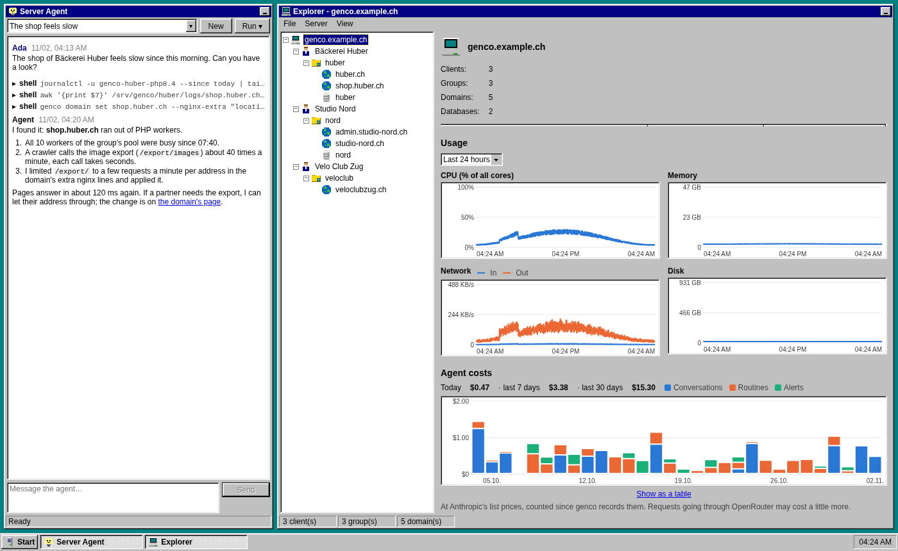

# genco

A hosting panel for a single Debian server, with a maintenance agent: an
LLM with root access that keeps the server running, sets up sites and
explains what it did. It looks like Windows 95.

genco is young and runs our own servers. Expect rough edges, and read
[Security](#security) before you put it on a server that matters.



## What it does

- **Groups of sites**: a client's sites share one Linux user, its files
  and databases. Each group runs its own PHP-FPM (8.2 to 8.5) and its Node
  or Rust apps as systemd units, in a sandbox, with resource limits.
  Groups can't read each other's files.
- **Domains**: static, PHP, Node or Rust, with Let's Encrypt certificates
  and nginx written for you. A Node app can have a public folder that
  nginx serves directly. A proxy domain forwards to another web server,
  e.g. while a site moves into genco. www.<domain> can redirect to the
  domain, with its own certificate.
- **Workers and schedules**: commands of a group that run all the time
  (Craft's queue, a server on a public port of its own) or at times like
  cron, in the group's sandbox; from the panel or `genco.toml`, Craft's
  queue and `update-statuses` without any config.
- **Deploys** from git, by hand or from CI with a scoped token, or a
  release a CI built and uploaded: releases, shared folders (`.env`,
  uploads), build steps, `craft up`, rollback, and a check that the
  binaries run on this server. Craft, composer, npm and Cargo projects
  are detected without a config file. Apps get environment variables
  and secrets from the panel.
- **Build runners**: `genco runner` on another machine (it connects out,
  no open port) builds steps like `cargo build` in a container matching
  the server, so long builds don't slow down the sites; without one the
  server builds itself.
- **Databases**: MariaDB or PostgreSQL per group, imports, downloads for
  developers (Craft databases without personal data).
- **Files**: a file manager with an editor, uploads, zip and unzip.
- **Mail**: mail domains with mailboxes and forwards, webmail
  (SnappyMail), spam filter and DKIM (Rspamd), SRS for forwards, and a
  DNS helper that compares the records a domain needs with what it has.
- **Backups**: restic every night, per group (files, databases, SQLite
  files, mail) and for the server's config.
- **The agent**: a chat in the panel or in the terminal (`genco chat`).
  It runs routines (a daily health check, a weekly update round, a
  weekly security review) and looks into problems the minute checks
  find; when an admin has to act, the admins get a mail, a webhook or
  both (Settings → Notifications).
- **Updates** of genco itself: signed releases, checked every night;
  patch releases install themselves if the server allows it, the rest
  with one click or `genco update --yes`, with a backup and an automatic
  rollback if the new version doesn't come up.
- **Admins** with two-factor login, invites by mail, an activity log of
  every change, a password store, usage stats per server, group and
  domain, and what the agent costs per day.
- Deleting a domain, database, group or mailbox needs a confirmation by
  mail.

## Install

genco is tested on and recommended for **Debian 13 (trixie)**, x86_64; it
expects a fresh server (other Debian releases may work, other
distributions don't). On a fresh Debian 13 server, as root, with the
panel's domain pointing to it:

```sh
curl -fsSL https://github.com/chuchi-dev/genco/releases/latest/download/install.sh | bash
```

It asks for the panel's domain, an email for Let's Encrypt, an Anthropic
or an OpenRouter API key for the agent (Claude Opus 5.5) and the first
admin.
`genco setup` then hardens ssh and the firewall, installs nginx, PHP,
Node, MariaDB, Postfix, Dovecot, Rspamd, restic and SnappyMail, and
starts genco.

[docs/OPERATIONS.md](docs/OPERATIONS.md) covers a fresh server step by
step, working without the panel or the agent, restoring a site from
backup and moving a whole server.

## Security

genco runs as root and gives an LLM a root shell. The agent's
instructions keep it careful (deletions need an admin's confirmation by
mail, it treats what sites and logs contain as data), but prompt
injection is a real risk: don't let people you don't trust write to the
agent or control what it reads without a look from you.

Please report vulnerabilities privately, see [SECURITY.md](SECURITY.md).

## Development

```sh
cd webui && npm ci && npm run dev    # vite on :5173, proxies /api to :4100
cd server && cargo run -- --config ./config.toml serve
```

`config.toml` for development:

```toml
data-dir = "./data"
anthropic-key = "..."
```

`scripts/build.sh` builds a static binary with the webui embedded. A tag
`v*` builds a release on GitHub.

[AGENT.md](AGENT.md) has the conventions for changes (for people and
coding agents), [docs/PLAN.md](docs/PLAN.md) the design, milestones and
backlog.

## License

Licensed under either of [Apache License, Version 2.0](LICENSE-APACHE)
or [MIT license](LICENSE-MIT) at your option.
